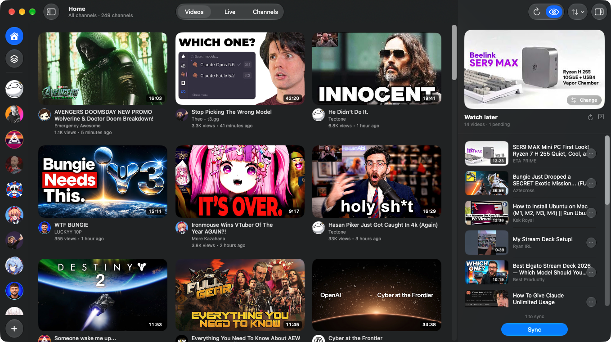
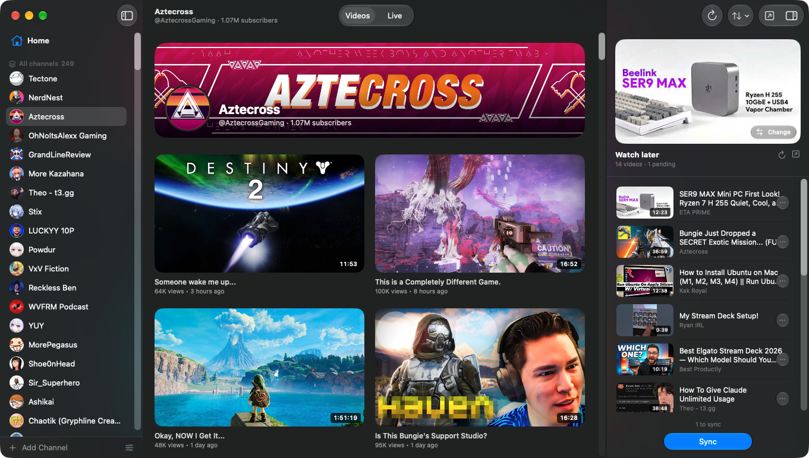

# YT Curator

A native macOS app for curating a YouTube playlist. Browse the channels you follow (grouped into
loadouts), stage playlist edits — add, remove, reorder — and sync them to YouTube when you're ready.

YouTube access is unofficial: you sign in on the real Google page inside the app, and its session
cookies drive YouTube's internal web API (InnerTube). No API key or OAuth app is involved, and
nothing leaves your Mac except requests to YouTube and GitHub (update checks).



The home feed aggregates the newest videos from your channels (or one loadout of them). Drag a
video onto the playlist on the right, reorder or remove items, then press **Sync**.



Open the sidebar for your full channel list; collapsed, it becomes a rail of channel avatars.

## Install

1. Download `YT-Curator-<version>.dmg` from the [latest release](https://github.com/Deli5150/yt-curator/releases/latest) and open it.
2. Drag **YT Curator** onto the **Applications** shortcut.
3. The app is ad-hoc signed, not notarized, so open it the first time with right-click → **Open**
   (or run `xattr -dr com.apple.quarantine "/Applications/YT Curator.app"`).

Requires macOS 26 or later. After that, the app updates itself: **YT Curator → Check for Updates…**,
and it checks automatically every few hours (Settings → Updates).

## Build from source

Needs Xcode 26+.

```sh
swift build                 # debug build
swift test                  # parser + logic tests
scripts/bundle.sh --install # release build → build/YT Curator.app, copied to /Applications
```

## Releasing

Add a `## <version>` section to `CHANGELOG.md`, commit, then run `scripts/release.sh <version>`.
It bumps `VERSION`, builds the app and its DMG, tags, pushes, and publishes the GitHub release that the
in-app updater installs from.

## Layout

- `Sources/YTCurator/YouTube` — sign-in (WKWebView), InnerTube transport with a rate-limit-aware
  request gate, and the parsers (the only code that knows YouTube's response shapes)
- `Sources/YTCurator/Store` — channels/loadouts store, staged edits, completed marks, feed cache
- `Sources/YTCurator/Features` — SwiftUI views and models
- `Sources/YTCurator/App` — app entry and the updater
